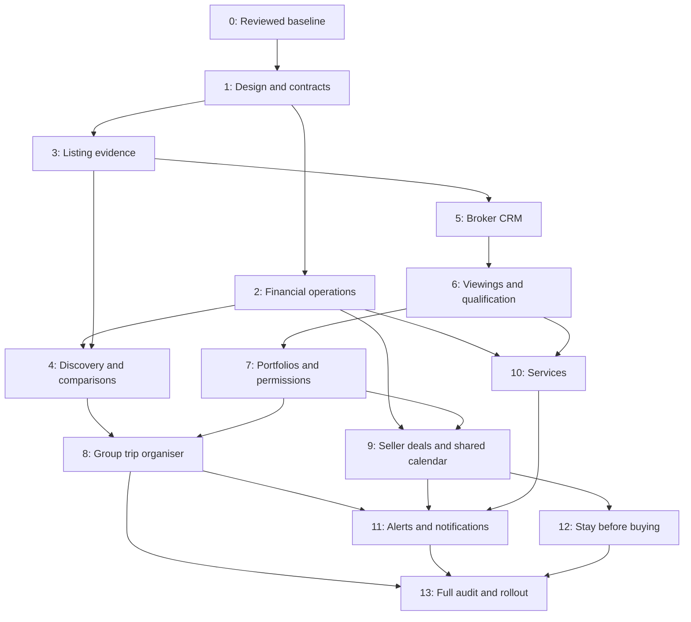

# 9bhk complete feature implementation plan

Prepared: 13 October 2026. Execution resumed: 20 October 2026. Status audited: 20 October 2026. See [current implementation evidence](IMPLEMENTATION_PROGRESS.md). The existing visual design is complete per the user and is outside the remaining work. Testing follows implementation. No production deployment has occurred.

## Phase status at the current worktree

The plan contains **14 phases (0–13), not 12**. **0 of 14 phases have documented evidence meeting their stated completion criteria.** Code has been written toward phases 0–12; phase 13 has no release-validation evidence. This count uses each phase's **Done when** condition, not the presence of a migration, helper or API route. The latest combined changes were pushed to `origin/codex/audit-fixes` as `4ffafa3`; they are not merged to `main`. No staging migrations or provider transactions were run as part of this work.

| Phase | Current state | Main gap before it can be called complete |
|---|---|---|
| 0 — Reviewed baseline | Repairs committed; scoped independent re-review passed | Review final diff, migrate staging data, verify real auth/payment recovery |
| 1 — Permissions/shared infrastructure | Design accepted; role-scoped contracts, audit and outbox code written | Integrate and verify role journeys, permissions and shared error handling |
| 2 — Financial operations | Refund/payout adapters, deposits and policy snapshots written | Approve terms/destinations, configure providers, reconcile in staging and verify operator workflow |
| 3 — Listing evidence | Facts, media/evidence, review expiry and completeness code written | Verify guest filtering, evidence display and staff review workflow |
| 4 — Discovery/quotes | Comparison, flexible-date, occasion and price-context contracts written | Verify full search-to-checkout consistency and provenance in app flows |
| 5 — Broker CRM | Opportunities, stage history, tasks, matching and team assignments written | Verify broker intake-to-outcome, assignment and revocation flows |
| 6 — Qualification/viewings | Questions, appointment lifecycle, conflict guards and feedback written | Verify concurrent slots, stay conflicts and participant access |
| 7 — Portfolios/mandates/documents | Versioned grants, approvals and private document access written | Verify cross-device recipient access, withdrawal and audit history |
| 8 — Shared trip organiser | Group planning, roles, conversations and funding records written | Verify multi-account trip, reload, revocation and payment journeys |
| 9 — Seller/deal coordination | Activity counts, offers, co-broker records and sale-state guards written | Verify owner workflow, approvals, milestones and stay/sale consistency |
| 10 — Optional services | Service orders, approvals, payment/refund and payout paths written | Confirm provider operations and reconcile a complete service lifecycle |
| 11 — Saved searches/notifications | Matching, preferences, reminders and in-app outbox written | Verify scheduled delivery, opt-outs, retries and operator visibility |
| 12 — Stay before buying | Opt-in, enrollment and single-use credit records written | Approve commercial terms and verify a buyer's stay/viewing/credit journey |
| 13 — Full audit and rollout | Earlier limited checks exist for baseline only | Final-diff review, full test/build/staging/browser/provider pass and release approval |

The visual design is not a blocker in this count. A phase remains open when its behavior and acceptance evidence are missing. The user deferred the testing phase until implementation work is done, so these gaps are recorded rather than reported as passing.

## 1. Objective and scope

Deliver every feature proposed in the guest, broker/realtor, and seller research, together with the operational work required to make them reliable. The releases below sequence delivery; they do not remove features from scope.

The product supports three connected journeys:

- **Guests:** discover a suitable whole property, compare the actual group cost, organise the trip, book services, and receive arrival/support information.
- **Brokers/realtors:** qualify enquiries, match properties, organise viewings, follow up, collaborate, and record deal/commission progress.
- **Sellers/owners:** present their property, control broker/document access, understand buyer activity, compare offers, and coordinate stays with sale activity.

Public inventory continues to require whole-property listings with at least three bedrooms. Seaside, hill station, city and countryside remain equal settings. Private broker inventory below the public floor cannot become publicly bookable through a share link.

The authoritative scope checklist is [the expansion requirements](.planning/feature-expansion/REQUIREMENTS.md). Every requirement has a phase and a demonstrable completion condition.

## 2. Starting point

Read [IMPLEMENTATION_STATUS.md](IMPLEMENTATION_STATUS.md) and [IMPLEMENTATION_PROGRESS.md](IMPLEMENTATION_PROGRESS.md) before execution. The current worktree is on `codex/audit-fixes`; baseline repairs and feature expansion are committed on that branch. Existing foundations include:

- Supabase authentication, account hydration and access controls.
- Server-priced reservation holds, captured-payment reconciliation and split funding.
- Host-owned listings, calendar blocking, seasonal/weekend rates and financial review requests.
- Persisted broker clients/properties/subscription expiry.
- Booking messages, support tickets, moderated completed-stay reviews.
- Group-plan, membership, invitation, shortlist and vote backend records.
- Public catalog projection, listing/document guards and operational audit records.

Recorded baseline checks passed 70 tests, typecheck, a clean production build and local page/script probes. They are historical evidence, not validation of the current expansion. A resumed independent review approved a limited repair and initial-feature scope; the final aggregate diff has not been reviewed. New database migrations are unapplied; credentials require rotation; refund/payout adapters have not been exercised with providers. Existing catalog key coverage also does not establish that every new interface string is translated.

Reuse these foundations after validating them. Do not build competing authentication, property, reservation, message or group systems.

## 3. Delivery architecture

Retain Next.js App Router, React, Supabase/PostgreSQL, Razorpay and the existing CSS design system. Use one property identity with separate **stay**, **sale** and **private broker** capabilities. Separate guest payment accounting from purchase-offer and broker commission records.

| Area | Proposed records / extension |
|---|---|
| Property evidence | `property_media`, floor plans, room/bed configuration, accessibility evidence, amenity measurements, inspection history and verification scope |
| Discovery | Saved searches, comparison selections, date-range quotes and bounded comparison snapshots |
| Broker CRM | Leads, client requirements, opportunities, activities, tasks, assignments, duplicate candidates and explicit match reasons |
| Viewings | Availability windows, viewing appointments, confirmations, cancellations, attendance and feedback |
| Portfolios | Selected properties, agency branding, versioned share grants, expiry and revocation |
| Seller permissions | Property mandates, broker assignments, consent records and capability-specific grants |
| Document room | Document versions, access grants, view/download audit events, expiry and withdrawal |
| Sales | Offers, revisions, conditions, approval history, negotiated responsibilities and commission agreements/milestones |
| Group trips | Extend existing group records with proposed dates, roster, room allocation, itinerary and booking participant roles |
| Services | Providers, services, property compatibility, quotes, availability, service orders and cancellation terms |
| Notifications | Preferences, delivery jobs, outbox, attempts, deduplication and event-trigger subscriptions |
| Trial stays | Seller-approved programme terms, eligible bookings, credit records, application and reversal history |
| Financial operations | Extend existing order/refund/payout records with provider processing, reconciliation, disputes and deposit outcomes |

These names are proposed; Phase 1 must reconcile them with the actual schema before migrations are written.

### Required invariants

1. Server records determine identity, membership, eligibility, price, permissions and financial status.
2. Store money as integer paise at financial boundaries; record quote versions, currency, rounding and fee/tax inputs. A deposit is distinct from revenue.
3. Every inventory or pricing decision is validated against the live authoritative property and reservation state.
4. Buyer qualification labels distinguish self-reported details, contact verification and reviewed evidence. They never imply guaranteed ability to pay.
5. Verification labels disclose the exact item, method, date and reviewer. They never imply blanket legal title, safety or access guarantees.
6. Share and document access is scoped, expiring and revocable at the server. Already downloaded files cannot be recalled; the interface must not promise otherwise.
7. Matching uses declared requirements, property facts, budget, location and timing. Protected personal characteristics must not determine housing access or lead priority.
8. A financial request, provider acknowledgement and completed transfer are separate states. No implicit escrow or guaranteed commission protection.
9. Notification retries cannot create duplicate messages, reservations or charges. Marketing consent and transactional delivery are separate preferences.
10. Every shipped guest/broker/seller journey supports English, Tamil and Telugu interface text, keyboard navigation, browser zoom and reduced motion.

## 4. Phases and acceptance criteria

### Phase 0 — Establish a reviewed, deployable baseline

**Requirement:** F01. **Dependency:** none. **Owners:** platform/security lead and independent reviewer.

- Inventory all staged, unstaged and untracked repairs; preserve the original comparison base and review migration ordering.
- Finish an independent review using the same failed review context when execution resources are available; resolve actionable defects and verify the final diff.
- Reconcile historical bookings, ownership, below-floor inventory and legacy payment references before applying migrations to staging.
- Rotate exposed credentials through an authorised operator; coordinate history cleanup separately from normal code changes.
- Configure staging Supabase confirmation/recovery/SMS, fresh Razorpay test keys, webhook delivery and scheduled hold expiry.
- Record the baseline schema, API contracts, actual environment settings and operational responsibilities.

**Done when:** the reviewed baseline builds cleanly, staging migrations and ownership tests pass, real staging sign-in/payment recovery journeys pass, and no known critical/high issue remains unresolved. Production remains a separate release decision.

### Phase 1 — Product design, permissions and shared infrastructure

**Requirement:** foundation for F03 and all feature phases. **Dependency:** 0.

- Design mobile and desktop navigation for guest, broker and seller workspaces; map role switching without duplicate identities.
- Write the permission matrix for owner, assigned broker, agency member, buyer, guest organiser, group member, provider and staff.
- Design loading/error/empty/permission-denied states before implementing happy paths.
- Define migration conventions, typed server contracts, pagination, audit events, idempotency keys and a background job/outbox interface.
- Plan translations and accessibility alongside each screen; audit the English-only strings introduced in the repair branch.
- Use the existing application design system for any remaining feature integration. Stitch is not a dependency or an active design workflow.

**Done when:** journeys, contracts, permissions, design references and test scenarios are reviewable; required feature controls are connected to the application and can be verified in their role journeys.

### Phase 2 — Complete payment, refund, deposit and payout operations

**Requirement:** F02. **Dependency:** 0–1. **Owners:** transaction/backend lead, finance operator and QA.

- Add idempotent provider refund dispatch, webhook/status reconciliation and retriable failures to the existing refund review queue.
- Add reviewed host payout execution/history using the approved provider arrangement and verified destinations.
- Define deposit collection, inspection evidence, proposed deductions, guest response, release/refund and dispute escalation.
- Snapshot approved cancellation, fee, tax and settlement rules with each reservation; do not apply later policy edits retroactively.
- Give staff a reconciliation queue for unknown, duplicate, late, partially funded and mismatched captures.
- Test browser closure, delayed events, expiry during payment, partial group funding, cancellations and interrupted provider processing.

**Done when:** staging money movements reconcile to the recorded ledger; retries are safe; a guest/host can see the actual status and supporting references; recorded finance procedures have an accountable operator. Purchase deposits and broker commissions are not routed through stay checkout by default.

### Phase 3 — Evidence-backed listings and listing-quality assistance

**Requirements:** G02, S05, D02. **Dependency:** 1.

- Extend media with room labels, floor plans, dimensions, bed layouts, accessible routes and property-specific evidence.
- Add structured overnight capacity, visitor/event capacity, pool fencing, ground-floor bedrooms, step-free access, pet facilities, workspace and parking details.
- Show missing versus supplied versus reviewed evidence explicitly. Reviews have a scope/date and can expire or be withdrawn when the underlying property changes.
- Build a listing completeness checklist and a staff evidence review queue. Completeness is not a verification badge.
- Require host approval for relevant events/services; no universal party, shoot or accessibility claims.

**Done when:** guests can filter on genuine recorded features, inspect supporting media, and see when/how a specific fact was reviewed. Missing evidence never becomes a positive claim.

### Phase 4 — Comparison, occasion discovery, flexible dates and pricing context

**Requirements:** G01, G03, G04, S06. **Dependency:** 2–3.

- Compare up to four properties using the same dates/party composition: trip total, refundable deposit, optional extras, beds, amenities, restrictions and available evidence.
- Price/filter/sort by the selected trip total; display any per-person split as an explanatory calculation rather than another charge.
- Add occasion filters using explicit host permissions and capacity; preserve those requirements into the booking request.
- Add bounded nearby-date quote searches respecting minimum stays, closures, seasonal prices and live reservations.
- Build seller comparable-listing views with source/date/location/size context; keep asking prices separate from completed-sale evidence and permit manual expert context.

**Done when:** comparison/search/checkout prices reconcile, unavailable dates cannot be booked, occasion claims have supporting data, and price context discloses its provenance and limits.

### Phase 5 — Qualified leads, broker pipeline, follow-ups and matching

**Requirements:** B01–B04, B08. **Dependency:** 1, 3.

- Extend the current client roster into enquiries/opportunities with budgets, locations, timing, requirements and explicit information provenance.
- Add New, Contacted, Viewing, Negotiation, Closed and Lost stages, stage history and configurable next actions.
- Capture permitted enquiry sources and imported contacts with consent/source attribution. Flag probable duplicates for review; do not silently merge records.
- Add individual/team assignments, handover history, overdue tasks and a daily work list.
- Implement transparent rules-based property matching with visible reasons and editable requirements before considering model-based ranking.
- Build role-scoped team reporting and contact/WhatsApp actions with permitted templates. An integration must not send messages without the applicable consent/authorisation.

**Done when:** an enquiry can travel from intake to outcome with a responsible broker, next action and history; reassignment and duplicates preserve records; expiry/revocation blocks unauthorised agency access.

### Phase 6 — Buyer qualification, appointment scheduling and viewing feedback

**Requirements:** B06, S02. **Dependency:** 3, 5.

- Give sellers configurable, proportionate enquiry questions for purchase timeline, budget and financing status.
- Support reviewed evidence where explicitly requested, with restricted access and truthful status labels.
- Coordinate viewing slots with seller/host availability, stays, service windows and assigned brokers.
- Add confirmations, rescheduling, cancellation, reminders, attendance and structured post-visit feedback.
- Share precise directions only with authorised participants at the appropriate stage.

**Done when:** concurrent requests cannot confirm the same exclusive slot, a viewing cannot conflict with a blocked stay window, and each participant sees only the required details. A phone-verification badge never represents financial qualification.

### Phase 7 — Branded portfolios, seller mandates and private document rooms

**Requirements:** B05, S03, S07. **Dependency:** 3, 5–6.

- Build branded portfolios with selected properties, accurate agency attribution and scoped, revocable share access.
- Add seller-approved broker mandates, start/end dates and separate capabilities for marketing, editing, viewings, document sharing and offer handling.
- Require seller approval for sensitive listing changes; revoke dependent shares when permission ends.
- Version documents and allow owners to select who can view/download each version; add expiry, watermarking where supported, and audit history.
- Define access retention and identity-document handling. Do not publish raw ownership/ID documents or imply that watermarks prevent copying.

**Done when:** a client can view an authorised portfolio on another device; private inventory does not bypass public publication rules; permission withdrawal takes effect on future server access; document history remains auditable.

### Phase 8 — Complete the shared guest trip organiser

**Requirement:** G06. **Dependency:** 2–4, 7's reusable access-grant patterns.

- Reuse existing group plans, memberships, invitations, shortlists and votes; connect the new trip behaviors to the accepted application interface.
- Add dates, guest roster, room preferences/allocation, notes, itinerary items and booking-linked group roles.
- Distinguish collaborator, invited payer and booked guest; each role receives only appropriate information and actions.
- Connect split funding, reservation progress, shared instructions and group conversations.
- Support organiser transfer, invitation revocation, expiry and removal without letting removed members retain private future access.

**Done when:** multiple real accounts can shortlist/vote and organise one trip; permissions and payment state remain correct after reload, account switching, revocation and cancellation.

### Phase 9 — Seller dashboard, offers, co-broking and rent/sale coordination

**Requirements:** S01, S04, S08, B07. **Dependency:** 2, 5–7.

- Build the owner dashboard for activity, enquiries, appointments, feedback, offers and pending approvals.
- Add structured offers and revisions: price/currency, payment schedule, financing statements, conditions and proposed completion date.
- Compare offers without claiming that the highest price is necessarily the best outcome; record seller decisions and supporting notes.
- Record client/property introduction attribution, negotiated broker responsibilities, approved commission agreements and payment milestones; add an exception/dispute queue.
- Use one property/calendar for both stay and sale workflows. Set explicit rules for sale viewings during occupied stays; coordinate owner-approved access rather than overriding guest privacy.
- Make sold/withdrawn property transitions resolve future stays, active shares, offers and appointments through a controlled workflow.

**Done when:** owners can trace an enquiry through viewing/offer/decision, approvals and revisions cannot be silently overwritten, and stays/viewings/property sale status remain consistent. The app records agreements and milestones; it does not guarantee enforceability or automatic commission entitlement.

### Phase 10 — Optional services and provider operations

**Requirement:** G07. **Dependency:** 2–3, 6.

- Onboard approved cook/catering, transport and decoration providers with service areas, availability, capacity and property compatibility.
- Add provider quotes/confirmation, clear inclusions, delivery windows, fees and cancellation terms.
- Obtain host permission where necessary; decline incompatible services explicitly.
- Reuse financial/order infrastructure only after defining the separate service order and refund lifecycle.
- Support provider cancellation, replacement requests, service completion evidence and disputes.

**Done when:** a guest can request and receive an actual confirmed service from an available provider; a failed provider cannot leave the UI claiming fulfilment; charges/refunds and cancellation terms reconcile.

### Phase 11 — Saved searches and lifecycle notifications

**Requirement:** G05; shared delivery for B03/B06/S01. **Dependency:** 4–6, 8–10.

- Save property/date/budget/feature search criteria and channel/frequency preferences.
- Trigger alerts only after authoritative availability/price changes; deduplicate, rate-limit and coalesce them.
- Deliver consented viewing reminders, follow-up reminders, offer updates and trip/service changes through the shared outbox.
- Implement unsubscribe/quiet hours and separate marketing preferences from required transactional messages.
- Expose failed-delivery/retry queues to staff; keep private contacts and search text out of public analytics.

**Done when:** relevant changes deliver once through the selected channels, stale changes are revalidated before sending, opt-outs take effect, and delivery failures are visible to operators.

### Phase 12 — Seller-approved stay-before-buy programme

**Requirement:** D01. **Dependency:** 2, 6–9.

- Allow owners to opt in with versioned eligibility, viewing arrangements and any agreed purchase-credit terms.
- Link an ordinary paid stay to an acquisition enquiry without exposing unrelated guest data to brokers.
- Track optional credit issuance, expiry, application and reversal; require explicit seller approval.
- Prevent double application, changes to already accepted terms and advertised credits that have not been approved.

**Done when:** an opted-in buyer can book a normal stay and arrange a viewing; the agreed credit, if any, is traceable and applied at most once. This feature does not automatically refund stays or execute a property purchase.

### Phase 13 — Full-system audit, staging validation and rollout

**Requirement:** F03. **Dependency:** all applicable feature phases.

- Independently review each final release diff, including migrations and untracked files; resolve actionable findings and recheck the repaired snapshot.
- Run production-build checks plus real browser flows for all roles at mobile/tablet/desktop sizes and all supported locales.
- Run PostgreSQL/RLS tests for every role pair, revocation, concurrency, deletion/withdrawal, background retries and account changes.
- Test provider callbacks/delivery in staging; reconcile money and notification records against provider responses.
- Measure search/quote latency and page performance on representative devices/data sizes. Set numeric budgets from the measured baseline before release.
- Document support escalation, financial reconciliation, provider failure handling, retention, recovery and rollback.
- Release with feature flags and operator training; monitor errors, rejected mutations, conversion and fulfilment before broad enablement.

**Done when:** every scoped requirement has a demonstrated end-to-end result, release review is complete, operational owners accept their procedures, and deployment/rollback is explicitly approved. Disabled flags or empty/providerless screens do not count as complete features.

## 5. Dependencies and milestones

| Milestone | Deliverable | Release gate |
|---|---|---|
| A — Trusted baseline | Phases 0–2 | Independent review, staging identity/payment lifecycle and approved operations |
| B — Better discovery | Phases 3–4 | Evidence-backed facts and consistent live quotes |
| C — Broker productivity | Phases 5–7 | Correct role scoping, functioning viewings and cross-device authorised portfolios |
| D — Guest/seller collaboration | Phases 8–9 | Real multi-account group/deal journeys and conflict-free scheduling |
| E — Services and alerts | Phases 10–11 | Available providers, consented delivery, retry/reconciliation procedures |
| F — Full product | Phases 12–13 | Trial-stay terms, complete scope acceptance and release approval |

Workstreams can proceed in parallel after common schemas/contracts are agreed. Integration and database rollout remain sequential at their dependency gates.

## 6. Execution organisation

When execution is requested, use bounded subagent assignments with explicit file/module ownership:

- **Platform/transactions:** server APIs, financial jobs, provider adapters and core security migrations.
- **Guest/discovery:** search, comparison, pricing presentation, group journeys and guest services UI.
- **Broker/seller:** CRM, portfolios, permissions, viewings, offers and owner dashboards.
- **Integration coordinator:** shared contracts, migration ordering, translations, local validation and release documentation.
- **Independent reviewer/QA:** read-only final-diff review and evidence-based acceptance; implementation agents do not self-certify independent approval.

Respect the actual available concurrency slots; rotate assignments instead of over-spawning. If a reviewer fails or quota is exhausted, preserve work and report the failure. Do not label the review passed or silently substitute self-review for an explicitly requested independent review.

Each feature PR/changeset contains schema/API/UI together where feasible, tests for its real failure modes, scope IDs, rollout flag and any deployment dependency. Use isolated work branches/worktrees when simultaneous edits could conflict. Migrate expand/backfill/validate before removing old contracts.

## 7. Decisions to resolve before dependent implementation

| Decision | Needed before | Proposed starting position |
|---|---|---|
| Cancellation, tax/fee, deposit and host settlement rules | Phase 2 | Versioned business-approved rules; no new percentages invented by code |
| Refund/payout provider arrangement and bank verification | Phase 2 | Fresh test credentials and a reviewed processing/reconciliation procedure |
| Evidence reviewers and claim expiry | Phase 3 | Item-specific review; visible source/date; no blanket verified label |
| Property pricing/comparable data source | Phase 4 | Permissioned, attributed data; asking and completed-sale prices kept separate |
| Agency/team and commission agreement model | Phase 5/9 | Explicit seller/broker approvals, recorded responsibilities, dispute workflow |
| Document access and retention | Phase 7 | Least access, explicit expiry, audited future access, owner revocation |
| Messaging/calendar providers | Phase 6/11 | Required consent and verified delivery; no unsolicited automatic outreach |
| Service supply and cancellation responsibilities | Phase 10 | Start only with providers who can confirm availability and handle failures |
| Trial-stay purchase credits | Phase 12 | Owner opt-in and approved versioned terms; never an automatic blanket discount |

Capture decisions as short records with owner, date and affected requirements. Unresolved integration/business decisions block only their dependent work; specifications and independent foundations continue.

## 8. Verification and success measures

### Mandatory test scenarios

- Price/availability consistency from search through comparison, hold and capture; simultaneous bookings and viewings.
- Lost callbacks, duplicated events, expired/partially funded holds, provider errors, cancellation/refund/deposit/payout retries.
- Owner versus assigned/unassigned broker, agency member versus outsider, invited versus revoked member, buyer versus unrelated guest, provider versus staff.
- Document version withdrawal, revoked share access, assignment changes, duplicate leads and conflicting offer edits.
- Signup/recovery/OTP, cross-device hydration, account switching, sign-out and permission changes during an open session.
- Translation coverage and actual screen copy, keyboard/focus/zoom, responsive layouts, slow/offline/error states and script delivery.
- Notification deduplication/consent/quiet hours; service cancellation; single-use purchase credits and reversal.

Use existing tests and isolated PostgreSQL fixtures as the starting point. Add tests that exercise real behavior and boundaries, not copies of implementation expressions. Provider and browser end-to-end checks supplement local mocks.

### Measure after each release

| Persona | Measures |
|---|---|
| Guest | Search-to-shortlist/booking conversion, comparison use, abandonment after quote, booking failures, group completion and support resolution |
| Broker | Time to first response, overdue follow-ups, relevant-match acceptance, viewing attendance and enquiry-to-offer outcomes |
| Seller | Qualified enquiries per listing, feedback completion, offers received, permission/document issues and time to an accepted offer |
| Operations | Reconciliation exceptions, refund/payout age, duplicate delivery, provider cancellations and access-control failures |

Set improvement targets after collecting a reliable baseline; no conversion or revenue uplift is promised by this plan.

## 9. Estimation and release policy

Phase 0 produces a scoped estimate using actual integration access, data quality, available team capacity and the existing code delta. No fixed completion date is assumed here. Financial operations, permissions/document rooms, shared scheduling and service fulfilment are the largest dependency risks; interface-only delivery must not conceal unfinished backend/provider work.

Phase 13 includes a final scope reconciliation: every requirement must be accepted or explicitly marked blocked/deferred with the user's decision. Production deployment, credential/history operations and irreversible financial actions retain their separate authorised execution steps.

## 10. Research context

The plan translates researched patterns into 9bhk-specific requirements. It does not treat competitor marketing as proof of local demand. Guest transparency/collaboration patterns are documented by [Airbnb pricing](https://news.airbnb.com/total-price-display-is-now-standard-globally), [collaborative wishlists](https://www.airbnb.co.uk/help/article/1236) and [accessibility](https://www.airbnb.com/accessibility). Broker workflow precedents appear in [Magicbricks Smart Diary](https://property.magicbricks.com/) and [LeadSquared real-estate CRM](https://www.leadsquared.com/real-estate-crm/). Seller management precedents appear in [Housing's seller dashboard](https://support.housing.com/support/solutions/articles/4000200869-what-is-a-seller-dashboard-) and [Magicbricks seller services](https://www.magicbricks.com/sell-property). The stay-before-buy programme and combined rental/sales operations are 9bhk product hypotheses to test during implementation.
